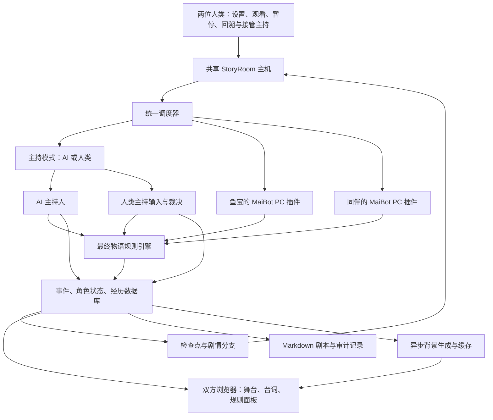

# 三个 AI 自主跑团：最终物语规则、剧本记录与共享舞台改造方案

日期：2026-10-10
适用基础：已安装的 StoryRoom 0.3 连接修复版、MaiBot SDK 跑团 PC 插件、现有 Live2D 资源。
文档性质：实施方案。2026-10-10 已开始实施，独立开发版位于 `storyroom-next`，本机入口为 `http://127.0.0.1:8791/`。暂停、接管、分支回溯、剧本导出、AI 主持调度与属性检定子集已有实现；完整职业、战斗、升级规则和真实三 AI 远程联调尚未完成。实际交付范围见 [开发版说明](../deliveries/storyroom-autonomous-0.4-dev-2026-10-11/README.md)，本文其余部分仍是整体目标，不能当作全部已通过验收。

## 1. 我们要完成什么

运行参与者为三个 AI：鱼宝、同伴角色、AI 主持人。人类在开始前设定世界、角色和规则范围，点击开始后可以放手观看，不需要逐句点名、回答问题、批准行动或主持投骰。三个 AI 按规则自主探索、讨论、战斗和推进故事。

最终体验应具备以下能力：

- 玩家行动有原因、有检定、有实际后果，下一段剧情建立在此前发生的事情上。
- AI 主持人负责叙事和 NPC，两个玩家只控制自己的角色；规则计算由程序执行。
- 每个人的公开发言按顺序保存，支持实时阅读和导出 Markdown 剧本。
- 故事经历、角色资源、羁绊与章节进度持久保存，重启后能够接着跑。
- 两个人看到同一个房间、场景、角色和事件顺序。
- 任一获准控制房间的人可以暂停；暂停后停止推进故事和播报，恢复时继续原来的进度。
- 可以回溯到已保存的剧情节点，恢复当时的世界、角色和记忆，在新分支中继续；旧分支保留供查看。
- 可以随时接管主持人，停用 AI 主持人的生成与发布，由人类输入叙事和裁决，两个 AI 玩家继续参与；之后可交还 AI 主持人。
- 表情符合当前表现，短暂表情结束后恢复正常；背景随实际场景变化，可按设置自动生成图片。

“完全放手”指正常游戏中无需人工操作，不代表模型调用次数无限，也不代表允许 AI 忽略规则。运行前设置调用、图片和会话预算；遇到无法处理的规则或连接故障时明确暂停并说明原因，不能靠编造结果继续。

## 2. 当前状态与目标的差距

以下状态依据本机代码与最近一次安装验证，不能代表同伴主机此刻的实时状态。

| 部分 | 当前已知状态 | 需要达到的状态 |
|---|---|---|
| 玩家连接 | 本机 PC 插件加载成功；已保存的同伴地址与 PC 密钥认证通过；上次检查连接开关关闭 | 能分别看到认证、协议、心跳、任务领取、模型生成和结果提交状态 |
| 自动讨论 | 两个 PC 轮流讨论；提问和行动等待人类主持人；默认每轮最多四次发言 | AI 主持人自动回答与裁决，运行调度由房间统一控制 |
| 正式规则 | 三项技能；行动检定固定为 1d20 加技能值 | 使用最终物语的角色卡、检定、资源、冲突和成长机制 |
| 剧情 | 预设阶段、标记与结局；当前玩家提示词禁止新增世界观和主线 | 世界基础稳定，AI 可在边界内共创支线，章节有目标和结局 |
| 记录 | 有事件、经历、插件日志与行动记录 | 有完整公开台词、规则记录、章节摘要和可读剧本 |
| 表情 | 有表情映射与回执；舞台按 visual.revision 更新 | 中性基线正确，短暂表情有到期时间，多浏览器同步恢复 |
| 模型素材 | 由平台主机读取模型目录，并提供给浏览器 | 明确素材归属和版本，资源缺失时直接显示诊断 |
| 背景 | 当前主要是 CSS 场景装饰与渐变 | 支持图片背景、场景缓存和异步自动生图 |
| 暂停 | 当前“暂停讨论”会关闭调度并取消排队中的自主任务 | 暂停整场游戏，涵盖运行中任务、晚到回复、声音和背景切换 |
| 时间回溯 | 尚未验证存在完整的状态回溯功能 | 从检查点恢复世界、角色、知识和进度，建立新分支并保留旧记录 |
| 主持权切换 | 有人工主持按钮，未形成 AI／人类主持的切换协议 | 明确当前主持者；接管后 AI 主持人停止工作，支持交还与上下文同步 |

现有表情异常的具体原因尚未在实际浏览器中复现；不得直接认定是模型本身坏了。现有密钥认证成功，也不等于已经完成真实模型回复验证。

## 3. 总体结构与部署位置

继续使用 StoryRoom 作为共享平台，两个 MaiBot 继续作为玩家。新增 AI 主持人工作进程、规则引擎和统一调度器。



主机只运行一份。现在你们访问同伴提供的网址，因此共享平台的 GM、规则、场景和网页改动主要应部署在同伴主机；你这边更新 PC 插件即可。更新你的本机平台，不会自动修改同伴正在提供的房间。

AI 主持人不需要再安装一套 QQ 机器人。推荐在主机上运行独立 GM 服务，单独配置模型，或通过主机 MaiBot 的模型能力调用。即使用同一个模型，主持人与两个玩家仍分别使用独立上下文与身份。三个 AI 的模型密钥留在各自负责调用的电脑上。

## 4. 六个现有问题的解决方案

### 4.1 角色默认表情不正常

先区分四类问题：选错模型、模型基础参数异常、表情残留、Idle 动作覆盖表情。当前完整鱼宝模型包含 neutral、happy、smug 三份表情，不应宣称它已经具备全部情绪动画。

实施步骤：

1. 增加模型预览诊断：显示角色实际 avatar、模型入口、表情清单、中性映射、Idle 动作及执行回执。
2. 提供“恢复默认表情”操作，在不改变人物位置、嘴型和正常呼吸的前提下清理上一表情控制的参数，并应用本模型的中性基线。
3. 检查默认参数、中性表情和动作是否控制同一参数；若存在冲突，为该模型配置明确的控制优先级。以模型实际参数名为准，不凭拼写猜测修改。
4. 把持续心情与暂时表情分开。心情可以长期保存；普通待机默认使用中性表情，短暂表情由本次台词或事件触发。
5. 给暂时表情增加共享的开始时间、到期时间和版本。建议初始显示 3～6 秒；台词较长时可延至播放结束，之后恢复默认。
6. 新表情、换模型或切换房间时，取消旧恢复计时器，防止旧计时器把新表情错误清掉。刷新页面按服务器当前状态恢复。
7. 不支持的表情回退到中性，并明确标注“模型不支持此表情”。思考气泡等网页效果可以补充表现，但要与模型自带动画区分。

验收：进入房间即为正常待机；连续触发开心、默认、得意和缺失表情后均可恢复；两位浏览器状态一致；动作和语音不把默认脸永久改掉。

### 4.2 无法判断 MaiBot 是否联通，看起来没有反应

把“在线”拆成可观察的过程，而不是只有一个等待标签。

| 状态 | 页面应显示什么 |
|---|---|
| 插件未加载 | 实际加载错误、宿主和 SDK 兼容信息 |
| 连接关闭 | 提示在本机插件中启用连接 |
| 认证失败 | 区分地址错误、PC 密钥错误和误用 GM 密钥 |
| 协议不匹配 | 显示两侧协议版本，停止调用模型 |
| 在线旁听 | 最近心跳与同步游标；提示当前没有模型任务 |
| 等待发言 | 当前轮到谁、正在等待哪个任务 |
| 正在生成 | 开始时间、任务编号与已等待时长 |
| 已生成但未发布 | 显示暂停、现场变化或提交重试等原因 |
| 失败或断线 | 错误分类、最后成功时间、下一次重试时间 |

增加免费连通性自检：核对实际插件加载、房间身份、协议、心跳及模拟任务往返，不调用模型。另提供显式的“真实模型测试”，产生一条带模型来源与耗时的正式测试记录，不把固定演示当作真人工智能输出。

最近一次本机只读验证中，PC 密钥有效，但 connection.enabled=false。这是当时未开始持续连接的已知原因；下一次部署仍应读取实时状态，不直接沿用旧结论。

启动自主游戏前检查两个 PC 和 AI GM 都可用。人类主持模式改为检查两个 PC 与当前人类主持者，不因已停用的 AI GM 缺少心跳而报错。任何必要参与者掉线时暂停房间，不能悄悄让主持人代替玩家做决定。旁听和心跳本身不调用模型。

### 4.3 界面和后台不适用最终物语规则

房间增加明确的 ruleset 和 ruleset_version。新建最终物语房间使用新规则；旧的简化房间保留原有规则和数据，不把原来的三个技能强行解释成正式角色卡。

| 模块 | 改造内容 |
|---|---|
| 角色卡 | 属性及基础／当前骰型、身份／主题／出身、等级、职业、技能、羁绊、装备 |
| 资源 | HP、MP、IP、物语点及所采用规则要求的其他资源 |
| 检定 | 属性组合、骰子结果、修正、难度、特殊结果、能力影响与合法重投 |
| 冲突 | 回合、行动资格、目标、攻击、伤害、防御、抗性、状态与资源消费 |
| 成长 | 会话结算、经验、升级和合法的角色构建变更 |
| 网页 | 正式角色卡、检定卡、资源栏、战斗顺序、技能选择与规则出处 |

规则计算必须由程序执行。AI 主持人可以解释为何选某种检定，但不能自己宣布骰点或任意扣资源；PC 也不能自行宣布成功。模型提出行动和能力使用后，程序校验角色是否拥有该能力、当前是否能使用以及资源是否足够。

规则资料按你们实际使用的中文版和勘误锁定版本。官方资料确认游戏鼓励玩家共创世界，角色卡包含物语点、羁绊和资源；不能仅把 d20 换成两颗骰子就宣称完整支持。[官方介绍](https://need.games/fabula-ultima/)、[官方角色卡](https://www.needgames.it/wp-content/uploads/2022/11/Fabula-Ultima-Character-Sheet.pdf)。

第一版优先完整覆盖两张预设角色卡和一个短冒险所用的规则，再扩展职业、敌人与扩展书。未支持的规则明确列出，玩家优先选择支持的能力；确实无法处理时暂停并记录原因。两个 PC 的遭遇需要专门测试平衡，不直接照搬针对更多玩家的遭遇。

当前心情0～100与合作信任是项目自己的表现数据，继续保留；它们不替代最终物语的正式羁绊机制。

### 4.4 主持人 AI 没有接入

新增 GM 身份及专用任务队列。GM 与玩家的权限和可见信息不同，不把第三个普通 PC 当作主持人。

GM 可以描述现场、扮演 NPC、回答玩家问题、提出检定、安排冲突、根据实际结果裁决叙事后果、推进场景与结算会话。两个 PC 自主决定各自角色的发言、行动、物语点使用、能力与成长选择。

每次 GM 输出分为公开台词和结构化操作。例如公开台词是“门后的脚步停了”，系统操作则是“请求某角色进行已定义的检定”。平台验证操作后才提交世界状态。不得从一段普通叙事里猜测扣血、发物品等系统行为。

建议允许的操作包括：publish_narration、answer_question、request_check、start_conflict、resolve_action、propose_world_change、change_scene、end_session。名称是设计建议，不是已经存在的 API。

GM 使用本房间的受限身份，不拿人类管理员的完整密钥，也不直接操作数据库。隐藏线索、NPC 秘密和未揭露计划只进入 GM 上下文；PC 只收到公开事实和自己已知的信息。

当前主持人的人工按钮整合为完整的人类主持面板，按第 6.1 节处理接管、手动输入与交还。正常自主流程不要求人类确认每次裁决。规则中的玩家选择和共创许可，由对应 PC 的决策任务处理，不能让 GM 替 PC 决定。

### 4.5 队友形象是否必须在我本地加载

结论：完整素材由共享房间的主机提供；你加入同伴房间时，只需浏览器自动下载并显示，不需要手动安装同伴模型到自己的 MaiBot 或 VT 文件夹。

| 位置 | 需要什么 |
|---|---|
| 共享 StoryRoom 主机 | 两套完整模型、表情、引用动作、贴图与映射 |
| 鱼宝的 MaiBot 电脑 | PC 插件、房间地址、PC 密钥；无须同伴模型 |
| 同伴的 MaiBot 电脑 | 对应 PC 插件与配置；无须把模型作为消息上传 |
| 双方浏览器 | 从同一主机加载资源并本地渲染，允许缓存 |

若改由你运行共享主机，则你需要取得并安装同伴提供的完整授权素材。这是主机素材部署，不是每个观看者都手动复制一份。

建议建立角色素材清单：角色ID、资源版本、模型入口、文件指纹、中性映射和支持的表情。启动前检查所有引用资源。换模时释放旧实例，以新资源版本刷新缓存。

角色身份不与模型文件名混为一谈。换形象不更换 PC 密钥，不丢失角色卡和经历。网页镜像的是共享房间中的角色状态，不是直接镜像对方个人 VT 窗口。

### 4.6 背景默认，希望 AI 根据场景生成图片

增加独立的场景系统和异步生图任务。图片生成不作为游戏主循环的必经等待步骤。

流程：GM 确认场景变化 → 保存地点／时间／天气／氛围等公开描述 → 查询已有图片 → 命中缓存直接使用，否则创建生图任务 → 图片完成后核对场景版本 → 双方切换到同一背景。

推荐设置：

- 每个场景保存 scene_id、scene_revision、公共描述、图片提示词、资源ID和生成状态。
- 生图采用独立图像服务配置，不假定现有 DeepSeek 聊天 API 能直接生成图片。
- 提示词固定世界美术风格和横向构图，背景默认不绘制两位玩家角色，避免与 Live2D 重复。
- 使用公开场景信息，不能把 GM 的隐藏线索画出来泄露剧情。
- 优先复用地点图片；只有地点或显著环境改变时生成，不为每句台词生成一张。
- 玩家提出“去森林”不直接换背景，必须先成为实际场景变化。
- 每次运行可设图片上限，显示生成状态、耗时和服务错误。失败时继续使用已有背景，不影响投骰或台词记录。
- 任务完成时核对剧情分支、运行版本与场景版本；过期图片可存入缓存但不显示，回溯前的图片不能覆盖回溯后的场景。房间暂停时不自动切换，恢复后再判断是否仍适用。
- 两个浏览器使用主机的同一图片资源ID；异步任务用幂等键去重，防止两位观看者各生成一份。

图像服务选择、尺寸、额度和密钥在实施前配置。本文不执行生图，也不新增收费调用。

## 5. 真正自主运行的调度流程

当前默认每轮四次讨论用尽后要人类继续；新模式由调度器自动安排下一阶段，同时设置整场运行预算。

```text
建立世界与角色 → 开场叙事
    → 玩家讨论、提出问题或行动
    → GM回答问题 / 处理行动
    → 如需检定：规则程序投骰
    → 如需玩家能力或资源选择：给对应PC发送选择任务
    → 程序结算最终结果
    → GM描述后果，提交确认事实与经历
    → 检查章节目标、角色目标和下一场景
    → 进入下一轮，或结束本次会话
```

玩家讨论时可以轮流发言，战斗中遵循正式冲突规则，不能把网页上的固定轮流顺序当作战斗规则。

GM 不需要对每句闲聊都调用一次。收到实际问题、行动或规则结果时触发相应任务；连续讨论达到阈值后由 GM 收束并提供明确的可行动局面。重复内容、长期无进展和连续模型失败需要可观察的恢复策略，达到限制则暂停。

每个任务绑定 room_id、branch_id、role_id、task_id、run_epoch、world_revision 与 lease；GM 任务另检查 gm_epoch，区分主持权切换前后的任务。字段名称为设计建议。房间同一时刻只允许一个有效的推进调度器。模型重试与断线重传可以发生，但同一任务结果只能提交一次；同一次规则结算不能重复扣资源。

调度器按主持模式路由：AI 模式给 GM 工作进程派任务；人类模式把待回答问题、行动提案和规则结果送到主持面板，等待人类发布。人类发布后继续安排两个 PC 的回复与选择，不自动启动 AI GM。等待人工输入属于正常等待，不能套用 AI 请求超时重试。

世界采用“持续设定＋有收束的章节”。章节完成后进行成长和经历整理；可按运行设置自动开启下一章，也可结束本次运行。不能用无限新增剧情掩盖当前目标永远无法完成。

## 6. 随时暂停的准确语义

需要新增房间级运行状态，不能只沿用当前“暂停后续讨论”。界面分别提供“暂停整场游戏”“接管／交还主持人”和“时间回溯”，三种操作的作用不同。

| 状态 | 含义 |
|---|---|
| READY | 设置完成，尚未开始 |
| RUNNING | 可领取任务、生成、结算和发布 |
| PAUSING | 正在撤销任务和通知浏览器停止播放 |
| PAUSED | 不再推进剧情或发布新台词 |
| ERROR_PAUSED | 故障导致暂停，显示明确原因 |
| FINISHED | 本次运行已结束，允许查看与导出 |

获准控制房间的人点击暂停后，服务器在事务中停止任务领取、增加 run_epoch，并撤销旧任务的提交资格。所有状态变更在同一数据库事务内检查运行状态、任务身份和版本，防止“检查时没暂停、提交时已经暂停”的竞态。

服务端确认暂停后：

- 不再发起新的玩家、GM或生图请求。
- 尽力取消运行中的请求；无法取消的晚到结果不能提交、发布或继续推动故事。
- 已正式提交的事件保留，不删历史；尚未播放的台词停止自动播放。
- 向双方浏览器推送暂停事件，停止当前朗读并取消旧播放队列。
- 图片完成后可缓存，但不自动切换场景。
- 恢复前按当前主持模式核对两个 PC 与 AI GM 或人类主持者；只重建尚未正式提交的必要任务，不重复已有投骰和资源结算。

建议使用服务端事件推送或 WebSocket，避免只靠两秒轮询传播暂停。目标是在网络正常时，服务器确认暂停后双方页面两秒内停止播报；断网页面显示状态未知，不能声称已同步。

暂停不能保证已发出的模型或生图请求不计费；程序应准确记录请求状态和可获得的实际用量。进程重启后默认恢复为 PAUSED，避免无人注意时继续产生调用。

### 6.1 人类接管主持人，再交还 AI

主持模式单独保存为 gm_mode=AI 或 HUMAN，不能拿房间是否暂停来代替。RUNNING＋HUMAN 表示两位 AI 玩家仍可行动，但叙事、NPC 发言和主持裁决由你们输入；PAUSED 则无论谁主持，都停止整场推进。

| 操作 | AI 主持人 | 两个 AI 玩家 | 房间状态 |
|---|---|---|---|
| 暂停整场游戏 | 停止新任务，旧结果失效 | 停止新任务，旧结果失效 | PAUSED |
| 接管主持人 | 停止生成与发布 | 按人工主持发布的内容继续响应 | 保留原运行状态；切换期间短暂阻止提交 |
| 交还 AI 主持人 | 同步当前现场后恢复任务 | 继续按规则参与 | 原来暂停则仍暂停，原来运行则继续 |
| 时间回溯 | 撤销旧运行任务 | 撤销旧运行任务 | 新分支先进入 PAUSED |

接管流程：

1. 主机确认操作者有主持权限，锁定当前房间版本，短暂阻止并发提交。
2. 增加 gm_epoch，撤销 AI GM 的排队任务和提交资格，尽力取消正在生成的请求。晚到结果不得发布台词、裁决或改动世界。
3. 切换为 HUMAN，记录当前主持者。保留已提交的剧情、规则结果、玩家提案和未回答问题，不重复投骰，不把接管视为回溯。
4. 双方页面停止旧 GM 的朗读队列，显示“人类主持：某某”，列出待处理事项。没有依赖旧 GM 裁决的 PC 任务可继续；受切换影响的任务先等待现场同步。
5. 操作者直接输入主持台词；发布后，两位 AI 玩家接收同一份正式事件并继续响应。暂停中的房间可以准备草稿，恢复后才能正式发布推进事件。

主持面板至少包含以下操作：

- 输入场景叙事、NPC 发言、回答玩家问题，明确标注发言身份。
- 查看两位 PC 的行动提案，选择规则允许的检定与难度，查看程序投骰结果并描述后果。
- 通过结构化操作处理资源、冲突、场景变化与会话结算，保留规则校验和操作记录。
- 查看未完成的检定、能力选择和裁决，避免遗漏玩家问题。
- 一键暂停整场游戏、交还 AI 主持人或打开回溯面板。

普通文本不直接改变角色资源或确认事实。人工主持也通过规则引擎结算；若确需覆盖规则，应使用独立、带原因的人工修正操作并留痕，不能无声修改骰点或数据库。

两个人都可以获得主持权限，但同一时刻只有一位有效的主持输入者。用 controller_id、控制租约和版本检查避免双方同时裁决；另一位可以观看或请求移交。主持者断线或租约失效时等待重新接管，必要时暂停，不自动把主持权交给 AI。

交还流程：同步当前分支的世界状态、角色卡、已确认经历、未解决事项、人工主持期间的事件及 GM 可见秘密；清除 AI GM 未提交的旧计划，再增加主持版本并切换为 AI。AI 接着最新事实主持，不重演人工已经完成的场景。是否恢复整场运行由 run_state 决定，交还按钮不能解除原有暂停。

记录保留实际操作者与来源，例如“主持人（人类：某某）”或“主持人（AI）”；NPC 发言同时保留 NPC 名称和控制者。重启保留主持模式与记录，控制租约重新获取，房间仍默认暂停。

### 6.2 时间回溯：恢复旧现场，在新分支继续

建议采用“检查点＋事件重放＋剧情分支”。回溯不仅改聊天记录，还要恢复角色数值、世界事实和 AI 当时知道的信息。原来的未来保留为旧分支，退出当前有效剧情。

支持在完整事件提交后、检定或冲突结算完成后、场景切换和会话结束时建立检查点。第一版只允许回到可完整恢复的边界，不能回到一段模型输出的中间或一次扣资源事务的中间。每条台词可展示对应的可回溯节点；若该处不可恢复，应标明最近的有效节点。

用户流程：

1. 暂停整场游戏，等待服务端确认，撤销旧任务的提交资格和播放队列。
2. 在时间线选择节点，预览当时的场景、角色资源、已知事实和当前状态的差异。
3. 确认后，以选中节点建立新分支，保存父分支、分叉事件、操作者和原因。旧分支不删除。
4. 从最近检查点恢复，并只重放到选定节点。恢复与分支切换在一致的事务／锁保护下完成。
5. 两个 PC 和 GM 清除旧运行上下文，重新同步新分支；双方浏览器显示同一分支、场景与记录。
6. 新分支保持 PAUSED，展示恢复结果。操作者选择 AI 或人类主持模式，再点击继续，生成新的后续故事。

| 必须恢复的内容 | 具体范围 |
|---|---|
| 世界 | 当前场景、时间、公开事实、NPC 状态、秘密、已揭露线索、章节目标与标记 |
| 角色与规则 | HP、MP、IP、物语点、装备与物品、状态、羁绊、经验、等级、能力、冲突回合及行动资格 |
| 知识与经历 | 每位角色当时已知的信息、已确认经历、情绪与关系数据，以及有依据的长期变化 |
| 运行位置 | 尚待裁决的提案、待回答问题、未完成的玩家选择与主持模式；任务按新版本重建 |
| 展示 | 当时的模型资源引用、有效背景和中性表情；已过期的临时表情不重新播放 |

任务租约、网络连接、正在播放的音频和旧计时器不作为活跃对象恢复。GM 草稿、计划和摘要也必须匹配目标节点，不能把旧未来的计划带回；无法可靠还原的派生摘要从有效事件重新生成。

事件采用不可变的唯一 ID。分支保存 branch_id、parent_branch_id、fork_event_id；当前有效历史由继承到分叉点的祖先事件和新分支事件组成。房间审计序号持续递增，剧本按分支有效历史排序，不把回溯解释为删除事件或倒退数据库序号。

回溯增加运行版本并切换 branch_id。所有 PC、GM、图片任务及发布请求都检查分支和版本，旧任务即使完成也不能在新分支提交。已消耗的模型费用仍属于原请求，账单统计不跟着剧情回退。

记忆必须随分支隔离：清空旧会话缓存、待发送回复和待提交经历，重建对应角色的上下文。长期记忆、embedding 检索和章节摘要只读取当前有效历史及该角色有权知道的内容；旧未来中“找到的线索”“获得的道具”和“认识的人”不能继续被召回。普通 QQ／个人 VT 的记忆不在房间回溯范围内，也不能把跑团旧未来写入它们。

图片缓存可以保留，但只有与当前公开场景描述、版本和资源条件匹配的图片才能复用；回溯前的晚到图片不能直接显示。所有页面停止旧语音，不重新朗读已归档的未来。

必须区分两种操作：

- **查看／回放旧分支**：只展示已记录的内容，不重新调用模型、不重新投骰，也不改变正在玩的分支。
- **回溯并继续游戏**：恢复状态后重新运行，可能产生不同发言与后续骰点。目标节点以前已经确认的骰点保留；之后发生的新检定产生新的有记录结果，不能把重跑伪装成原历史。

回溯无法撤销已经支付的 API 费用、人类已经看见的秘密或已导出的文件；未来若加入外部服务操作，也不能仅凭剧情回溯声称外部操作已撤销。这些影响在预览中说明。房间内部的虚构世界与角色状态按检查点恢复。

回溯限有控制权限的人操作，两位操作者同时回溯或接管时，只有版本匹配的一次操作成功，另一位重新同步。保留回溯审计和迁移前备份；检查点在一致状态下生成并绑定规则版本，恢复失败保持暂停且不暴露半恢复状态。检查点的保存频率、数量与旧分支保留期限可配置，第一版至少保留每个场景和会话结算节点。

## 7. 文字记录与剧本呈现

用同一份事件记录生成三种视图，保证可读性和事实一致。

| 视图 | 保存内容 | 使用者 |
|---|---|---|
| 原始公开记录 | GM、NPC、两个PC的实际公开台词；顺序、角色、时间、场景 | 两位参与者与角色可见范围内的上下文 |
| 剧本阅读版 | 场次、场景描述、说话者、原台词、已确认动作、可折叠规则结果 | 观看、展示与Markdown导出 |
| 技术审计版 | 任务状态、结构化操作、规则依据、骰点、状态前后、模型耗时、失败原因 | 排错与验收；按权限查看 |

每个事件分配单调递增的房间序号和唯一ID，浏览器按序补齐，刷新不丢内容。角色显示名可以改变，但记录绑定稳定角色ID，保留当时的名字。

记录另保存分支、AI／人类来源、实际操作者及主持权切换事件。默认阅读和导出当前分支的有效历史；查看旧分支时明确标注“归档分支”，不能把两种互相冲突的结局拼成同一剧本。暂停、接管与回溯的技术操作放在审计记录中，阅读版可显示简短的分段说明。

必须区分四类内容：说过的话、打算做的行动、规则结果、已经确认发生的后果。没有裁决的“我打开门”只能显示为行动提议，不能自动写成“门已打开”。NPC台词标明由主持人扮演。

建议导出形式如下，以下为格式示例，不是真实跑团日志：

```markdown
# 第一章：雾港来信

## 场景一：夜晚的码头

【主持人】雨落在木板上。仓库门内传来短促的敲击声。

【鱼宝】先别推门，我想看看锁和门缝。

【同伴角色】我去另一侧观察，有动静就叫你。

【规则记录】鱼宝进行本次已指定的属性检定。
实际骰点、修正、规则结果见关联记录。

【主持人】鱼宝发现锁没有扣紧，但门后有人抵住了门。

【已确认变化】鱼宝得知门后有人；没有进入仓库。
```

剧本阅读版默认不需要额外模型润色，可以直接由事件确定性生成。之后若提供“小说化改写”，应另存为衍生作品并关联原记录，不替换原台词，不凭空增加动作、关系或结局。章节总结注明其依据的事件范围。

公开剧本不包含GM隐藏计划、API密钥、PC密钥或完整私有模型输入；技术界面展示规则依据、操作摘要和用量即可，不需要记录模型隐藏思考过程。

## 8. 记忆与故事连续性

数据库负责当前角色资源、物品、确认事实、任务与场景；这些每次直接查询最新状态。长期经历从正式事件中形成，保留发生时间、相关角色、事件ID、是否有效与被修正记录。

PC读取自己知道的事实、自己的经历以及公开对话；GM读取完整房间设定、秘密和已确认事件。普通QQ和个人VT记忆仍与跑团房间隔离。

知识与检索以房间、有效剧情分支和角色权限为范围，包含该分支在分叉点以前继承的有效事件。回溯撤销旧未来的事实、经历、情绪和派生摘要，并重建索引的有效事件过滤；只换聊天窗口不算记忆回溯。人类接管期间确认的事实也正常进入记忆，交还 AI 后继续使用。

embedding 可以辅助召回远期经历与相关规则，但第一版不把它作为游戏能否运行的依赖。不得通过“模型可能记得”代替当前角色卡或规则计算。

把“事件引起心情变化”“关系变化”和“长期行为倾向变化”分别记录，并关联依据。角色成长应能回答“哪次经历带来了什么改变”，不直接把数值升级或一句自称成长当作连续人格发展的证据。

## 9. 建议修改的代码范围

下表是模块设计建议，具体文件名在实施时确定。

| 范围 | 现有入口 | 建议改动 |
|---|---|---|
| 正式规则 | storyroom/store.py、app.py里的固定技能和投骰 | 抽离rules/fabula_ultima；补充带版本的角色卡、检定与冲突结构 |
| 自主调度 | storyroom/room_features.py的schedule、control_talk | 新增房间级运行状态、主持模式路由、GM队列、能力选择窗口与故障恢复 |
| 主持人 | 当前仅人类host身份 | 新增GM worker、受限身份、模型路由、人工输入面板、控制租约及接管／交还协议 |
| PC插件 | plugins/storyroom_pc/plugin.py、worker.py | 支持新任务类型、规则能力选择、暂停／回溯同步及旧上下文清理，保持模型留在本机 |
| 数据与权限 | SQLite房间、任务、事件、经历表 | 增量迁移；新增规则状态、分支、运行与主持版本、来源、可见范围、场景资源、剧本导出索引 |
| 时间回溯 | 现有事件与状态存储 | 新增一致检查点、有效历史重放、分支切换、状态差异预览与回溯审计 |
| 表情 | web/stage.js、visual.js | 模型基线、默认恢复、到期时间、多浏览器同步及诊断 |
| 场景图片 | 当前stage.scene和CSS装饰 | 新增场景描述、图片资源服务、异步任务和缓存 |
| 阅读与控制 | web/app.js、index.html及相关面板 | 增加三AI状态、全局暂停、主持模式／人工主持面板、时间线与旧分支、规则面板、剧本视图与导出 |

新协议必须明确版本；主机和两侧PC一起升级，旧插件不能悄悄以旧协议参与。原QQ功能、个人VT语音、其他Heart插件不因本次改造被覆盖。AI主持人和场景生成的配置单独保存。

## 10. 实现顺序与小目标

| 顺序 | 任务 | 交付与验收 |
|---|---|---|
| P0-1 | 实际连接诊断与三方身份设计 | 两个PC可见真实心跳、任务往返；日志能定位认证或模型问题 |
| P0-2 | 修正模型默认状态 | 两个实际模型的默认、短暂表情、恢复、刷新与换模通过 |
| P0-3 | 房间级暂停机制 | 排队、生成中、提交边界、声音播放和重启场景均可正确暂停 |
| P0-4 | 事件与剧本导出基础 | 所有公开台词有稳定顺序；导出与实际事件一一对应 |
| P0-5 | 检查点与分支存储基础 | 完成一致快照、不可变事件与分支索引；用模拟状态验证恢复，不先开放不完整回溯 |
| P1-1 | 锁定规则版本、角色卡和首个冒险 | 明确支持范围，完成合法角色构建，不伪称全规则已支持 |
| P1-2 | 最终物语规则引擎 | 检定、重投、资源、所选技能、一次冲突与会话成长正确 |
| P1-3 | 接入AI主持人及三个AI调度 | 无人点名、回答或裁决，也能完成一次冒险闭环 |
| P1-4 | 秘密、经历与角色知识范围 | 玩家不知道未揭露秘密，能引用之前真实发生的事件 |
| P1-5 | 人类接管与交还主持人 | 生成中可接管，旧GM结果不发布；人工输入驱动两个PC，交还后AI接着当前现场主持 |
| P1-6 | 完整时间回溯 | 接入正式规则与角色记忆；回溯恢复数值、事实和场景，新分支继续，旧未来不进入上下文 |
| P2-1 | 共享资源清单与场景图片显示 | 双方浏览器加载相同模型和背景，无需每个PC手动安装模型 |
| P2-2 | 自动生图与缓存 | 已确认换景触发生图、错误不阻塞游戏、过期图片不覆盖现景 |
| P2-3 | 扩充规则、语音和故事展示 | 扩展技能与遭遇；完善朗读队列、章节阅读和可选衍生改写 |

先完成免费模拟模型与规则测试，再在设定预算内做真实三AI联调。模拟通过和真实跨两台电脑通过分别记录，不互相替代。

## 11. 最终验收清单

- [ ] 三个AI各有真实身份、独立上下文和可观察状态，固定演示与正式输出清楚区分。
- [ ] 预设冒险从开场到结束无需人类逐次操作；至少发生一次讨论、一次检定、一次冲突和一次会话结算。
- [ ] 两个PC自主选择行动、能力及可用的叙事资源，GM不替他们写决定。
- [ ] 骰点、伤害、资源、回合与成长符合锁定版本及明确支持的规则。
- [ ] 全部公开发言按序记录，刷新后不丢失，Markdown剧本可关联回原事件。
- [ ] 未确认提案、撤销内容和主持人秘密不会误变成PC已知事实。
- [ ] 双方可暂停；服务端确认暂停后不提交新剧情，旧请求晚到不发布；恢复不重复投骰或扣资源。
- [ ] AI GM 正在生成时可接管；接管确认后不再发起或发布 AI GM 任务，待处理问题与已结算结果保留。
- [ ] 人类输入叙事、NPC 发言和裁决后，两个 AI PC 正常回应；等待人工输入不触发 AI 超时或自动交还。
- [ ] 可交还 AI 主持人；它使用人工主持后的最新事实，不重做已完成裁决；原有暂停状态保持不变。
- [ ] 两人同时接管、交还或回溯时没有双重裁决；每条人工发言和修正都能追溯操作者。
- [ ] 回溯到检定、冲突或成长之前，资源、回合、物品、经验、事实及每个角色已知信息准确恢复。
- [ ] 回溯后的 PC／GM 不记得旧未来，旧模型回复、音频、计时器和图片不会发布到新分支。
- [ ] 旧分支可只读查看，默认剧本只含当前有效历史；回放不会重新调用模型或投骰。
- [ ] 双方浏览器同步同一回溯结果；恢复失败保持原有效状态并暂停，重启保留分支及主持模式。
- [ ] 普通待机为默认表情，临时表情结束自动恢复，多浏览器与刷新一致。
- [ ] 两台浏览器从同一主机加载两位角色的完整素材，身份和记忆不受换模影响。
- [ ] 背景由实际场景驱动；缓存、失败、暂停和晚到图片均有明确处理。
- [ ] 一位PC断线、AI模式下GM超时、错误输出或预算耗尽时，房间明确暂停而不是伪造进度；人类模式不要求AI GM在线。
- [ ] 重启后数据保留，默认暂停；真实模型测试、公开部署和声音测试各自记录结果。

## 12. 开始实施前需要准备的材料

规则书版本与采用的扩展、两张正式角色卡、首个短冒险的世界边界和目标、两套模型素材及表情清单、共享主机位置、GM与玩家的模型选择、每次运行预算、可选的图像服务配置，以及两位人类的控制权限、检查点频率和旧分支保留设置。

暂缺的材料可以先用明确标注的预设数据完成隔离测试，不影响编写调度、暂停和记录基础。任何本机API密钥、玩家密钥、私有数据库和备份都不放进共享方案或公开仓库。

本方案的第一轮成品应是：一个可以开始、暂停、恢复、回溯并导出剧本的真实三AI房间，允许人类接管和交还主持人，使用明确支持范围的最终物语规则，角色资源和故事经历可持续保存。之后再扩大规则覆盖和图像表现。
